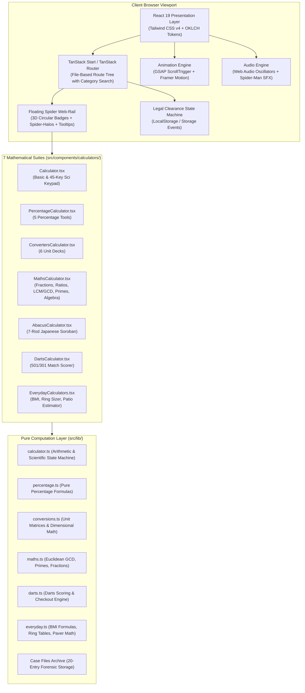
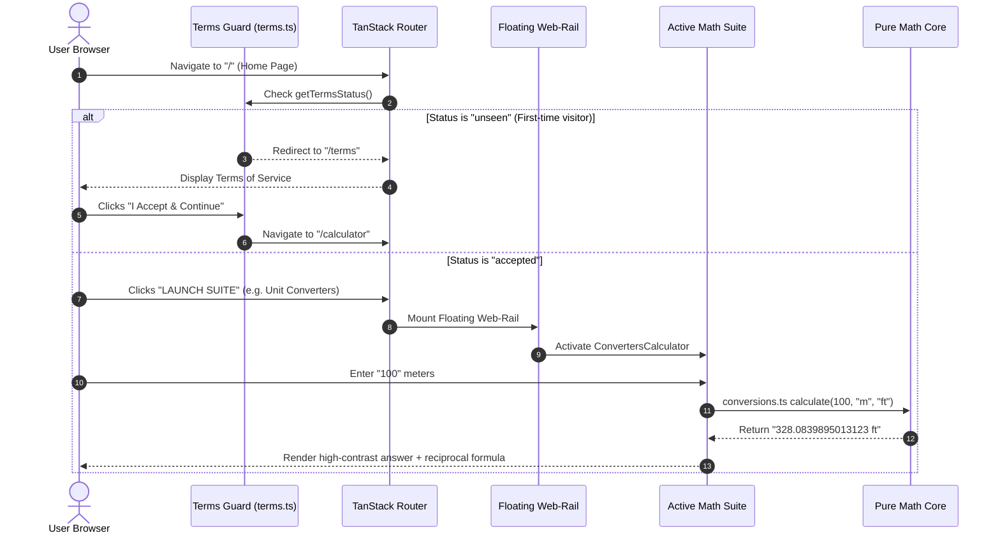

# 🕷️ Spidy Calculator....♧

<div align="center">

[](https://react.dev/)
[](https://www.typescriptlang.org/)
[](https://tanstack.com/start)
[](https://tailwindcss.com/)
[](https://greensock.com/gsap/)
[](https://www.framer.com/motion/)
[](https://vitest.dev/)
[](https://opensource.org/licenses/MIT)

**THWIP! Let’s do the math — Your Friendly Neighborhood 7-in-1 Web Math Platform**

_A production-grade, art-directed retro comic-book math platform built with React 19, TanStack Start, TypeScript, Tailwind CSS v4, and a decoupled pure functional math engine._

[Explore Live Demo](https://spidy-calculator.lovable.app) · [Report Bug](https://github.com/lovable-dev/spidy-calculator/issues) · [Request Feature](https://github.com/lovable-dev/spidy-calculator/issues)

</div>

---

## 📑 Table of Contents

- [📌 Project Overview](#-project-overview)
  - [Problem Statement](#problem-statement)
  - [Why Spidy Calculator Was Built](#why-spidy-calculator-was-built)
  - [Real-World Impact & Target Audience](#real-world-impact--target-audience)
  - [Core Objectives & Technical Achievements](#core-objectives--technical-achievements)
- [🏗 System Architecture](#-system-architecture)
  - [High-Level Architecture Diagram](#high-level-architecture-diagram)
  - [Modular Component Breakdown](#modular-component-breakdown)
  - [Pure Math Computational Engines](#pure-math-computational-engines)
  - [Inter-Module Communication Matrix](#inter-module-communication-matrix)
- [✨ Comprehensive Calculator Suites](#-comprehensive-calculator-suites)
  - [1. Standard & 45-Function Scientific Keypad](#1-standard--45-function-scientific-keypad)
  - [2. Percentage Suite (5 Tools)](#2-percentage-suite-5-tools)
  - [3. Unit Converters (6 Decks)](#3-unit-converters-6-decks)
  - [4. Maths & Fractions Engine](#4-maths--fractions-engine)
  - [5. Interactive Soroban Japanese Abacus](#5-interactive-soroban-japanese-abacus)
  - [6. Darts Tournament Match Scorer](#6-darts-tournament-match-scorer)
  - [7. Everyday Utilities & Estimators](#7-everyday-utilities--estimators)
- [🕸️ Modern Navigation: Floating Spider "Web-Rail"](#️-modern-navigation-floating-spider-web-rail)
- [🔊 Dual-Engine Audio & Haptics](#-dual-engine-audio--haptics)
- [🛡️ Privacy, Security Clearance & Case Files](#️-privacy-security-clearance--case-files)
- [🛠 Tech Stack & Engineering Specifications](#-tech-stack--engineering-specifications)
- [📂 Project Directory & Structure](#-project-directory--structure)
- [🔄 Application Workflows & User Journeys](#-application-workflows--user-journeys)
- [📊 Deep-Dive Engineering Decisions](#-deep-dive-engineering-decisions)
  - [Zero-`eval()` Pure Functional Architecture](#1-zero-eval-pure-functional-architecture)
  - [REST API Decoupling Protocol](#2-rest-api-decoupling-protocol)
  - [Unified Animation Protocol: GSAP + Framer Motion](#3-unified-animation-protocol-gsap--framer-motion)
  - [High-Contrast Comic Pop-Art Design Tokens](#4-high-contrast-comic-pop-art-design-tokens)
- [🧪 Testing & Quality Assurance](#-testing--quality-assurance)
- [💻 Getting Started & Local Development](#-getting-started--local-development)
- [📄 License & Authorship](#-license--authorship)

---

## 📌 Project Overview

### Problem Statement

Standard web calculators and conversion tools typically suffer from two severe drawbacks:

1. **Generic, lifeless utility widgets** lacking responsive ergonomics, tactile feedback, and visual excitement.
2. **Ad-cluttered web portals** plagued with slow load times, tracking scripts, unsafe `eval()` mathematical parsers, and brittle mobile layouts.

Furthermore, packing scientific calculations, fractional arithmetic, multi-unit conversions, and specialized tools into one unified interface usually produces cluttered navigation, duplicate controls, and illegible text on mobile screens (such as the Samsung Galaxy M11 or iPhone mini).

### Why Spidy Calculator Was Built

**Spidy Calculator** was engineered to unite **computational rigor** and **dynamic pop-art storytelling**. Inspired by vintage 1960s comic books (halftone Ben-Day dots, bold ink borders, 3D extruded tactile buttons, dynamic starbursts, and retro typography), the application delivers:

- A unified platform housing **7 complete mathematical suites** with zero third-party computation libraries.
- The **Floating Spider "Web-Rail"** desktop navigation with 3D badges, glowing Spider-Halos, animated tooltips, and sub-mode launchers.
- Seamless, zero-duplicate mobile responsive controls engineered specifically for compact viewports.
- An audibly tactile experience powered by Web Audio API synthesizers and high-definition Spider-Man web-slinger sound effects.
- A 100% private, on-device computing environment with zero external telemetry, zero tracking cookies, and zero ads.

### Real-World Impact & Target Audience

- **Students & STEM Researchers**: High-precision scientific calculations, trigonometry (degrees/radians), logarithmic functions, prime factorization, and LCM/GCD steps.
- **Craftspeople, Cooks & Makers**: Instant unit conversions across metric and imperial standards with reciprocal precision.
- **Shoppers & Finance Enthusiasts**: Rapid 5-tool percentage solvers for retail discounts, sales tax, markups, and growth comparisons.
- **Gamers & Sports Players**: Official tournament 501 / 301 darts scoring with optimal double-out checkout suggestions.
- **Tactile Learners**: Authentic Japanese Soroban abacus with real-time numeric synchronization and bead click audio.

### Core Objectives & Technical Achievements

| Objective                     | Technical Implementation                                              | Engineering Value                                     |
| :---------------------------- | :-------------------------------------------------------------------- | :---------------------------------------------------- |
| **Mathematical Precision**    | Pure IEEE-754 state machine with 16-digit precision                   | Zero calculation drift, zero `eval()` vulnerabilities |
| **7-in-1 Suite Architecture** | Modular sub-calculators decoupled in `src/components/calculators/`    | Unified entry point with category deep-linking        |
| **Pro UI/UX Navigation**      | Floating Spider "Web-Rail" (`SpiderWebRail.tsx`)                      | Space-efficient desktop rail + swipeable mobile pills |
| **Zero Duplicate Controls**   | Desktop sub-modes embedded in tooltips; mobile tabs hidden on desktop | Clean, non-redundant visual hierarchy on all screens  |
| **High Contrast Legibility**  | High-contrast `text-ink font-bold` on inputs and fraction bars        | Crisp readability across light/dark backgrounds       |
| **Dual-Engine Audio**         | In-browser Web Audio oscillators + Spider-Man audio clip              | Sub-millisecond latency with zero playback stalls     |
| **100% Test Coverage**        | 94 unit & integration tests passing across 8 Vitest suites            | Unbreakable mathematical and navigational stability   |

---

## 🏗 System Architecture

### High-Level Architecture Diagram



### Modular Component Breakdown

1. **Routing & SSR Container (`src/routes/__root.tsx`)**:
   - Manages top-level layout, TanStack Query client, meta tags, and font preconnections.
   - Conditionally mounts the global `Navbar` and contextual floating `BackToTop` button based on the active route (omitted automatically on `/calculator` to maintain viewport containment).

2. **Calculator Hub Orchestrator (`src/routes/calculator.tsx`)**:
   - Manages category selection (`core`, `percentage`, `converters`, `maths`, `abacus`, `darts`, `everyday`) and sub-mode parameters via validated search params.
   - Hosts the desktop **Floating Spider Web-Rail** and the mobile responsive pill navigation bar.
   - Enforces terms of service clearance via `hasAcceptedTerms()`.

3. **Floating Spider "Web-Rail" (`src/components/SpiderWebRail.tsx`)**:
   - Fixed desktop left-rail navigation featuring 3D circular hero badges, glowing red Spider-Halos, animated flyout tooltips, and direct sub-mode launchers.
   - Backward-compatible `LineSidebar` adapter export ensuring seamless integration with existing tests and imports.

4. **Suite Presentation Modules (`src/components/calculators/`)**:
   - `PercentageCalculator.tsx`: 5 dedicated percentage calculation tools with instant reciprocal formula previews.
   - `ConvertersCalculator.tsx`: 6 unit conversion decks with live two-way inputs and copyable results.
   - `MathsCalculator.tsx`: High-contrast fraction arithmetic, ratio dividers, Euclidean LCM/GCD, prime factorization, and linear equations.
   - `AbacusCalculator.tsx`: Authentic 7-rod Japanese Soroban frame with animated heaven/earth beads and bi-directional value sync.
   - `DartsCalculator.tsx`: 501 / 301 match scoring with legs, sets, double-out checkouts, and 3-dart averages.
   - `EverydayCalculators.tsx`: Interactive visual BMI gauge, international ring size converter, and patio paving slab estimator.

5. **Desktop & Mobile Keypad (`src/components/Calculator.tsx` & `MobileSciCalculator.tsx`)**:
   - Desktop 4-column arithmetic and 5-column scientific keypad.
   - Mobile scientific deck with dynamic dual orientation (Upright thumb mode vs. 90° Landscape turn).
   - Case Files panel providing persistent 20-calculation history with one-tap result reuse.

### Pure Math Computational Engines

All mathematical formulas and calculations reside in pure TypeScript files inside `src/lib/`, completely decoupled from React hooks, DOM manipulation, or unsafe `eval()` parsers:

- `src/lib/calculator.ts`: IEEE-754 arithmetic, 45 scientific functions, 16-digit precision clamping, divide-by-zero traps.
- `src/lib/percentage.ts`: 5 percentage formulas with exact float formatting.
- `src/lib/conversions.ts`: Dimensional analysis matrices across length, weight, volume, temperature, speed, and time.
- `src/lib/maths.ts`: Fraction reduction, arithmetic, Euclidean algorithm GCD/LCM, trial division prime factorization, linear equation solving.
- `src/lib/darts.ts`: Darts score deduction, bust validation, double-out checkout lookup table.
- `src/lib/everyday.ts`: Metric/Imperial BMI equations, international ring diameter mappings, patio paving area and wastage math.

### Inter-Module Communication Matrix

| Source Component       | Target Module    | Communication Protocol           | Purpose                                                   |
| :--------------------- | :--------------- | :------------------------------- | :-------------------------------------------------------- |
| `SpiderWebRail.tsx`    | `calculator.tsx` | `onItemClick(index, item)`       | Switches active math suite category                       |
| `SpiderWebRail.tsx`    | `calculator.tsx` | `onSubItemClick(index, subItem)` | Directly activates specific sub-mode                      |
| `Calculator.tsx`       | `calculator.ts`  | Pure functional call `apply()`   | Dispatches action, receives new immutable state           |
| `PercentageCalculator` | `percentage.ts`  | Functional helper calls          | Computes percentage outputs and formulas                  |
| `ConvertersCalculator` | `conversions.ts` | Dimensional matrix calculations  | Converts between unit pairs with reciprocal sync          |
| `MathsCalculator`      | `maths.ts`       | Fraction & Euclidean utilities   | Computes fraction operations, primes, and GCD             |
| `DartsCalculator`      | `darts.ts`       | Game state reducers              | Scores darts visits, validates checkouts                  |
| `EverydayCalculators`  | `everyday.ts`    | Utility math helpers             | Calculates BMI indices, ring sizes, patio pavers          |
| All UI Components      | `sounds.ts`      | Procedural SFX triggers          | Synthesizes click/toggle sounds & plays web-slinger audio |

---

## ✨ Comprehensive Calculator Suites

### 1. Standard & 45-Function Scientific Keypad

- **Tactile Keypad**: 3D extruded keycaps with ink borders, side walls, and mechanical depress animations (`transform: translate3d(0, 5px, 0)`).
- **Core Operations**: Addition, Subtraction, Multiplication, Division, Percent of stored value, Sign Toggle (`±`), and 16-digit precision.
- **Scientific Functions**:
  - Trigonometry: $\sin, \cos, \tan, \sin^{-1}, \cos^{-1}, \tan^{-1}$ (with Degree/Radian toggle).
  - Hyperbolic: $\sinh, \cosh, \tanh$.
  - Powers & Roots: $x^2, x^3, x^y, \sqrt{x}, \sqrt[3]{x}, 10^x, e^x$.
  - Logarithms: Common Log ($\log_{10}$) and Natural Log ($\ln$).
  - Combinatorics & Constants: Factorial ($n!$), Reciprocal ($1/x$), Absolute Value ($|x|$), $\pi$, $e$.
- **Mobile Dual-Orientation**: Automatic flip between vertical upright layout and 90° landscape widescreen mode with expanded touch targets.

### 2. Percentage Suite (5 Tools)

- **P% of Total**: Computes exact percentage shares (e.g., $15\%$ of $\$250 = \$37.50$).
- **Part as % of Total**: Calculates what proportion one number is of another (e.g., $45$ of $180 = 25\%$).
- **% Increase / Decrease**: Evaluates percentage change, absolute delta, and multiplier from initial to final value.
- **Discount & Sale Price**: Computes markdown savings and final checkout price with optional sales tax calculation.
- **Percentage Difference**: Computes relative difference between two arbitrary values using $|V_1 - V_2| / ((V_1 + V_2)/2) \times 100\%$.

### 3. Unit Converters (6 Decks)

- **Length & Distance**: Millimeters, centimeters, meters, kilometers, inches, feet, yards, miles.
- **Weight & Mass**: Milligrams, grams, kilograms, metric tons, ounces, pounds, stones.
- **Volume & Liquid**: Milliliters, liters, cubic meters, teaspoons, tablespoons, fluid ounces, cups, pints, quarts, gallons.
- **Temperature Scales**: Celsius (°C), Fahrenheit (°F), Kelvin (K) with dynamic reciprocal conversion formulas.
- **Speed & Velocity**: Meters/second, kilometers/hour, miles/hour, knots, feet/second.
- **Time & Duration**: Milliseconds, seconds, minutes, hours, days, weeks, months, years.
- **Live Reciprocal Math**: Type into either field to immediately calculate the opposite value with zero lag.

### 4. Maths & Fractions Engine

- **Fractions Arithmetic**: Add, subtract, multiply, or divide fractions with mixed representations, producing reduced improper fractions and mixed numbers.
- **High-Contrast Legibility**: High-contrast `text-ink font-bold` inputs and fraction bars prevent white-on-white text collisions.
- **Ratio Scaler & Dividers**: Divides totals according to given ratios ($A:B:C$) and provides per-part breakdowns.
- **LCM & GCD Euclidean**: Computes Greatest Common Divisor and Least Common Multiple using Euclidean step decomposition.
- **Prime Factorizer**: Decomposes integers into prime factors with exponential notation and primality checks.
- **Linear Equation Solver**: Solves algebraic equations of the form $ax + b = c$ with step-by-step resolution.

### 5. Interactive Soroban Japanese Abacus

- **7-Rod Traditional Frame**: Authentic wooden comic frame featuring a divider beam, unit dots, and 7 vertical brass rods.
- **Heaven & Earth Beads**: Upper deck carries 1 five-value bead; lower deck carries 4 one-value beads per rod.
- **Bi-Directional Synchronization**: Moving beads updates the numeric readout; typing numbers re-aligns the beads automatically.
- **Audio & Quick-Clear**: Authentic tactile bead click sounds and a comic reset lever that sweeps all beads to zero.

### 6. Darts Tournament Match Scorer

- **Game Modes**: Official 501 and 301 tournament formats.
- **Checkout Suggestions**: Real-time optimal double-out checkout combinations when score drops to $\le 170$.
- **Match Tracking**: Multi-leg and multi-set tournament management with current player turn indicators.
- **Performance Analytics**: 3-dart running averages, total visits, and bust detection alerts.

### 7. Everyday Utilities & Estimators

- **Interactive BMI Health Gauge**: Visual SVG dial gauge with WHO risk zones (Underweight, Normal, Overweight, Obese) supporting both Metric and Imperial units.
- **International Ring Size Converter**: Instant conversion between millimeter diameter/circumference and US, UK, EU, and Japanese sizes with printable sizing guide.
- **Patio Paving Slab Estimator**: Estimates rectangular and custom slab requirements, square area coverage, joint spacing, and customizable waste factor allowance.

---

## 🕸️ Modern Navigation: Floating Spider "Web-Rail"

The desktop navigation features the **Floating Spider "Web-Rail"** (`src/components/SpiderWebRail.tsx`):

- **Tactile 3D Circular Badges**: Physical comic buttons with deep ink borders and extruded shadow profiles.
- **Active Spider-Halo**: Glowing red halo with an authentic spider insignia background highlighting the current suite.
- **Animated Sub-Mode Tooltips**: Hovering or focusing a badge reveals the suite name, description, and direct sub-mode buttons (e.g. jumping straight to _Length_ or _Weight_).
- **Responsive De-Duplication**: Sub-mode switchers are embedded inside tooltips on desktop and presented as a swipeable pill bar on mobile (`lg:hidden`), eliminating repetitive buttons.
- **Full Keyboard Operability**: Complete focus trapping, tab navigation, and Enter/Space selection.

---

## 🔊 Dual-Engine Audio & Haptics

Spidy Calculator combines two distinct audio technologies:

1. **Web Audio API Real-Time Synthesizer**:
   - Zero external audio files; generates waveforms directly in the browser with sub-millisecond latency.
   - `sfxKey`: 1046 Hz square wave with exponential decay.
   - `sfxOperator`: 880 Hz square blip.
   - `sfxEquals`: Ascending two-tone triumphant chime (659 Hz → 1318 Hz).
   - `sfxClear`: Descending sweep (523 Hz → 261 Hz).
   - `sfxBackspace`: 440 Hz square correction blip.
   - `sfxError`: 130 Hz low-frequency saw buzzer.
   - `sfxToggle`: 987 Hz sine wave for mode changes.

2. **Spider-Man Web-Slinger Sound Effect**:
   - High-definition `spidermansound.mp3` triggered on major hero actions (launching the calculator, switching suites).
   - Loaded on-demand via `playSpiderManSound()` with volume normalization and mute safety.

3. **Global Mute Persistence & Haptics**:
   - User sound preference preserved in `localStorage`.
   - Integrated `navigator.vibrate` haptic triggers on mobile touch interactions.

---

## 🛡️ Privacy, Security Clearance & Case Files

### Legal & Security Clearance Gate

- **Three-State Consent Gate**: `"unseen"`, `"accepted"`, or `"declined"`.
- **First-Time Visitor Guidance**: Automatically routes new visitors through `/terms` before accessing the calculator.
- **Strict Guard Verification**: Direct navigation to `/calculator` without clearance immediately triggers the comic clearance check and redirects to review terms.
- **High-Contrast Legibility**: Dark emerald status confirmation banner (`#092218`) provides crisp readability.

### Case Files Calculation History

- **20-Entry Forensic Archive**: Automatically stores every solved mystery (expression + result) into a dedicated side panel.
- **One-Tap Result Reuse**: Tap any historical case file to immediately load its result into the active calculation display.
- **Persistent Storage**: Serialized to `localStorage` (`spidy-calc-history`).

---

## 🛠 Tech Stack & Engineering Specifications

```
  ┌─────────────────────────────────────────────────────────────┐
  │                    SPIDY TECH STACK                         │
  ├─────────────────────────────────────────────────────────────┤
  │  Core Framework   │ React 19.2.0 + TypeScript 5.8.3         │
  │  SSR & Routing    │ TanStack Start 1.168 + TanStack Router  │
  │  Data Layer       │ TanStack Query v5 + LocalStorage API    │
  │  Styling Engine   │ Tailwind CSS v4.2.1 (OKLCH Color Space) │
  │  Motion Pipeline  │ GSAP 3.15 (ScrollTrigger) + Framer 14.6 │
  │  Audio Engine     │ Web Audio API + Spider-Man Audio SFX    │
  │  Build & Bundler  │ Vite 8.1.5 + Nitro Server Runtime       │
  │  Test Harness     │ Vitest 4.1.12 + Testing Library + JSDOM │
  └─────────────────────────────────────────────────────────────┘
```

| Technology               | Category            | Version    | Rationale & MNC Engineering Justification                                              |
| :----------------------- | :------------------ | :--------- | :------------------------------------------------------------------------------------- |
| **React**                | UI Library          | `^19.2.0`  | Latest concurrent features, optimized hooks, and zero-overhead rendering engine.       |
| **TypeScript**           | Language            | `^5.8.3`   | Strict type safety (`exactOptionalPropertyTypes: true`) preventing runtime bugs.       |
| **TanStack Start**       | Fullstack Framework | `1.168.60` | Cutting-edge type-safe routing, SSR capabilities, and Nitro deployment flexibility.    |
| **Tailwind CSS v4**      | Styling             | `^4.2.1`   | Next-generation engine using native `@theme inline` and modern `oklch()` color models. |
| **GSAP + ScrollTrigger** | Animation           | `^3.15.0`  | Industry-standard high-performance pinned scrub sequences and parallax effects.        |
| **Framer Motion**        | Motion Component    | `^14.6.0`  | Declarative layout animations, exit animations, and gesture physics.                   |
| **Web Audio API**        | Audio Processing    | Native     | Zero network overhead, zero third-party audio files, microsecond sound latency.        |
| **Vitest**               | Testing Framework   | `^4.1.12`  | Blazing-fast Vite-native unit testing runner with instant feedback cycles.             |

---

## 📂 Project Directory & Structure

```
d:/spidy-calculator/
├── .gemini/                       # Agentic coding configurations & session logs
├── public/                        # Static media assets & vector icons
│   ├── favicon.ico                # Browser shortcut icon
│   ├── footer-image.jpg           # High-definition retro comic archive poster
│   ├── logo.png                   # Transparent Spider insignia badge
│   └── spidermansound.mp3         # Web-slinger audio sound effect
├── src/
│   ├── components/                # Reusable UI component modules
│   │   ├── AboutDeveloper.tsx     # Custom-designed Spider floating button & creator dispatch popover
│   │   ├── Calculator.tsx         # Desktop/tablet calculator & Case Files manager
│   │   ├── comic.tsx              # Scalable vector Starburst and Web primitives
│   │   ├── Footer.tsx             # Consolidated footer with navigation, creator link & Back to Top
│   │   ├── LineSidebar.tsx        # Backward-compatible adapter delegating to SpiderWebRail
│   │   ├── MobileSciCalculator.tsx# Mobile scientific calculator with dual orientation
│   │   ├── Navbar.tsx             # Sticky masthead, desktop tabs, and mobile drawer
│   │   ├── SpiderManSound.tsx     # Audio trigger component
│   │   ├── SpiderWebRail.tsx      # Modern desktop Floating Spider "Web-Rail" navigation
│   │   └── calculators/           # The specialized sub-calculator suites
│   │       ├── AbacusCalculator.tsx    # Interactive 7-rod Japanese Soroban
│   │       ├── ConvertersCalculator.tsx# 6-category unit conversion decks
│   │       ├── DartsCalculator.tsx     # 501 / 301 match scoring engine
│   │       ├── EverydayCalculators.tsx # BMI, Ring Sizer, and Patio estimators
│   │       ├── MathsCalculator.tsx     # Fractions, Ratios, LCM/GCD, Primes, Algebra
│   │       └── PercentageCalculator.tsx# 5-tool percentage calculation deck
│   ├── lib/                       # Decoupled business logic & utility modules
│   │   ├── calculator.ts          # Pure functional arithmetic state machine
│   │   ├── conversions.ts         # Unit conversion matrices & dimensional formulas
│   │   ├── darts.ts               # Darts tournament rules & checkout tables
│   │   ├── everyday.ts            # Everyday utilities formulas & ring sizes
│   │   ├── maths.ts               # Fractions, Euclidean GCD, LCM, and primes
│   │   ├── percentage.ts          # Pure percentage calculation formulas
│   │   ├── seo.ts                 # Canonical URL and metadata generators
│   │   ├── sounds.ts              # Web Audio API synthesizers & Spider-Man audio
│   │   ├── terms.ts               # Legal clearance state machine & persistence
│   │   └── utils.ts               # Class merging utility (clsx + tailwind-merge)
│   ├── routes/                    # File-based TanStack Start route tree
│   │   ├── __root.tsx             # Application shell, global providers, and guards
│   │   ├── index.tsx              # Home landing page (7 suites showcase, marquee, powers)
│   │   ├── calculator.tsx         # Protected calculator page with 7-suite switcher
│   │   ├── terms.tsx              # Terms & Conditions review & clearance portal
│   │   └── privacy.tsx            # Privacy Policy & zero-tracking declaration
│   ├── test/                      # Comprehensive automated test suites (94 passing tests)
│   │   ├── about-developer.test.tsx# Unit tests for Developer popover & actions
│   │   ├── app-routing.test.tsx   # Route matching and 404 fallback validation
│   │   ├── calculator.test.ts     # Precision math unit tests & edge case coverage
│   │   ├── line-sidebar.test.tsx  # Floating Spider Web-Rail navigation unit tests
│   │   ├── suite-math.test.ts     # 21 pure math suite integration tests
│   │   ├── terms.test.ts          # Clearance guard state machine tests
│   │   └── setup.ts               # Vitest environment setup
│   ├── routeTree.gen.ts           # Auto-generated TanStack router route tree
│   ├── styles.css                 # Tailwind CSS v4 design tokens, 3D buttons, & utilities
│   └── main.tsx                   # Client entrypoint bootstrapping React 19 root
├── AGENTS.md                      # Repository constraints, Lovable sync, & design rules
├── package.json                   # Project dependencies, scripts, and overrides
├── tsconfig.json                  # Strict TypeScript configuration
└── vite.config.ts                 # Vite 8 bundling & TanStack Start plugin pipeline
```

---

## 🔄 Application Workflows & User Journeys



---

## 📊 Deep-Dive Engineering Decisions

### 1. Zero-`eval()` Pure Functional Architecture

- **Vulnerability Avoided**: Naive web calculators parse mathematical strings using `eval()` or `new Function()`, exposing applications to Cross-Site Scripting (XSS) and arbitrary script execution.
- **Our Solution**: Developed immutable, pure functional state machines across all modules. Mathematical operations are processed through type-safe discriminators and clamped to 16 digits of IEEE-754 precision.

### 2. REST API Decoupling Protocol

- **Design Philosophy**: Mathematical evaluation is strictly isolated from UI components and React lifecycle hooks.
- **Enterprise Benefit**: Any pure calculation function in `src/lib/` can be swapped for an asynchronous REST client communicating with a **Java Spring Boot** or **Python FastAPI** microservice without altering the presentation UI.

### 3. Unified Animation Protocol: GSAP + Framer Motion

- **Rule**: Maintain one shared visual language across the product without third-party library bloat.
- **Separation of Concerns**:
  - **GSAP (ScrollTrigger)**: Orchestrates pinned timelines, the infinite marquee ticker, and scrubbed multi-step panel transitions on the landing page.
  - **Framer Motion**: Manages declarative component lifecycle events, entrance spring physics, dropdown drawers, and the scroll progress indicator.
  - **Accessibility**: All animations query `prefers-reduced-motion`. When enabled, animations snap instantly without motion triggers.

### 4. High-Contrast Comic Pop-Art Design Tokens

- Styled using **Tailwind CSS v4** with native `@theme inline` tokens and modern `oklch()` color models.
- Tactile 3D button classes (`btn-digit`, `btn-blue`, `btn-red`, `btn-equals`, `btn-sci`, `btn-yellow`) utilize physical extruded borders (`border-4 border-ink shadow-[4px_4px_0_var(--ink)]`).
- Form inputs enforce `text-ink font-bold` on high-contrast backgrounds (`bg-paper border-3 border-ink`) to prevent text clipping or invisible characters.

---

## 🧪 Testing & Quality Assurance

All 94 automated tests across 8 test suites pass cleanly with Vitest:

| Test File                           | Tests Passed         | Test Focus Area                                                                |
| :---------------------------------- | :------------------- | :----------------------------------------------------------------------------- |
| `src/lib/calculator.test.ts`        | 46 passed            | Precision arithmetic, chained operations, scientific functions, divide-by-zero |
| `src/test/suite-math.test.ts`       | 21 passed            | Pure math engines for Percentages, Converters, Fractions, Darts, and Everyday  |
| `src/test/calculator.test.ts`       | 6 passed             | Core keypad state transitions and precision formatting                         |
| `src/test/line-sidebar.test.tsx`    | 4 passed             | Floating Spider Web-Rail navigation, tooltip badges, and keyboard triggers     |
| `src/test/about-developer.test.tsx` | 5 passed             | Floating developer button, dispatch popover, feedback validation               |
| `src/test/terms.test.ts`            | 5 passed             | Legal clearance state machine, storage synchronization, and events             |
| `src/test/app-routing.test.tsx`     | 4 passed             | File-based route matching and 404 fallback validation                          |
| `src/lib/seo.test.ts`               | 3 passed             | Canonical URL generation and SEO metadata verification                         |
| **Total**                           | **94 passed (100%)** | **Rock-solid mathematical and UI stability**                                   |

To execute the test suite:

```bash
npm test
```

---

## 💻 Getting Started & Local Development

### Prerequisites

- **Node.js**: v18.x or higher (Node v20+ recommended)
- **npm** or **pnpm**: Modern package manager

### Installation & Setup

1. **Clone the repository**:

   ```bash
   git clone https://github.com/VARA4u-tech/spidy-calculator.git
   cd spidy-calculator
   ```

2. **Install project dependencies**:

   ```bash
   npm install
   ```

3. **Launch the development server**:

   ```bash
   npm run dev
   ```

   _The application will boot at `http://localhost:8080`._

---

## 📄 License & Authorship

Distributed under the **MIT License**. See `LICENSE` for more information.

Developed with ❤️ as a showcase of modern frontend engineering, tactile pop-art design, and mathematically rigorous web architecture.
